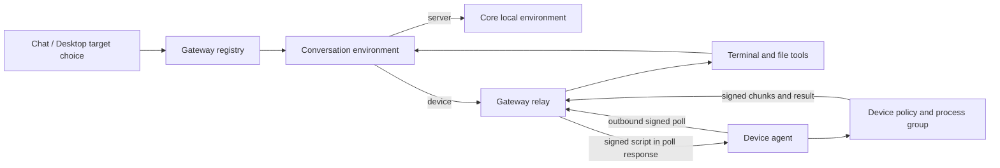

# Dirtside

Dirtside is a Hermes terminal backend. It sends terminal commands and file operations to a personal device selected for the conversation. Other conversations can keep running on the gateway server or use another paired device.

The device runs a foreground agent that polls your gateway over outbound HTTP. The same package provides chat commands, pairing, revocation and an optional native Desktop pane. It does not move the whole agent onto the device.

## Install

Install on the gateway and each device, in the Hermes profile that will use it:

```sh
hermes plugins install https://github.com/the-ai-entrepreneur-ai-hub/hermes-dirtside
hermes plugins enable dirtside
```

On the gateway, select the backend:

```sh
hermes config set terminal.backend dirtside
```

Restart the gateway and open a new conversation after changing the backend. Review the install disclosure before enabling it. The manifest requires Hermes >=0.22.7; Python >=3.11 and `pynacl>=1.5,<2` are required. The checks below used core `84a0301415edd6d1385207ec96e4d7f2b6c1fcd9`, not every supported release.

The configured default is `server`. To change it, set `plugins.entries.dirtside.settings.default_target` to a paired device name. An explicit conversation selection wins over that default. Cron defaults to server unless its own conversation has an explicit selection.

Leave `terminal.cwd` unset to start a fresh device environment in its home. Core expands an explicitly configured `~` on the gateway; Dirtside does not translate that path.

## Pair in four commands

After installing both ends, use these four commands. Chat commands run in an authenticated Hermes conversation on the gateway. Shell commands run on the device. Replace the example gateway URL and `PASTE_CODE` with your URL and the fresh code.

1. In chat, mint a single-use code:
   ```text
   /dirtside pair macbook
   ```
2. In the device's shell, pair:
   ```sh
   hermes dirtside pair https://gateway.example --name macbook --code=PASTE_CODE
   ```
3. In that shell, keep the agent running:
   ```sh
   hermes dirtside serve
   ```
4. In the conversation that should use it, select the device:
   ```text
   /dirtside use macbook
   ```

Codes expire after ten minutes. Keep them private; command arguments can enter shell history and process listings. Names use 1 to 32 lowercase letters, digits or hyphens. Use a name other than `server`, which is the server selector. Non-loopback URLs must use HTTPS; plain HTTP is accepted only for loopback.

`hermes dirtside status` shows the device's pairing, policy and recent local request activity. Optional per-user service commands are `hermes dirtside install-service --dry-run`, `hermes dirtside install-service` and `hermes dirtside install-service --remove`. Inspect the unit first. Actual service loading, login and reboot recovery were not validated here.

## Chat commands

| Command | Effect |
|---|---|
| `/dirtside` | Show this conversation's target and online devices. |
| `/dirtside devices` | List paired devices, OS and online state. |
| `/dirtside use` | Ask for an online device or server. Cancelling changes nothing. |
| `/dirtside use <name>` | Select that paired device for this conversation, even if currently offline. |
| `/dirtside use server` | Persist an explicit server choice, including over a device default. |
| `/dirtside pair <name>` | Mint a code and show the exact device-side pairing command. |
| `/dirtside revoke <name>` | Revoke its credential and cancel its live gateway requests. |

A target change applies from the next command, including when core already cached the conversation's environment. Work already dispatched keeps its original target. Selecting an offline or revoked device never silently runs that work on the server.

Core freezes the target's prompt facts once per session. Switching targets does not rebuild that prompt; start a new session for fresh facts. Shell snapshots stay separate per target, but core carries the conversation's recorded working directory across a switch. Supply an explicit `workdir` that exists on the new target when necessary.

## Native Desktop

Install the package locally on the Desktop machine as well if the gateway is remote. Desktop discovers `desktop/plugin.js` in the local unified package. In **Capabilities → Plugins**, enable **Dirtside**, which is off by default. Open its right-hand pane. If discovery needs a refresh, use the command palette's **Reload desktop plugins**.

The pane shows paired devices, online dots, OS, home, last seen and revoke buttons. Its target picker follows the focused saved conversation; the status bar chip shows the same target. Recent requests show command previews, state, exit code and a live output tail. Devices and requests poll every two seconds while the pane is visible. Target reads continue for the chip.

The REST helper uses the active gateway and profile. If the focused chat belongs elsewhere, controls stay disabled until you switch to its gateway/profile. An unsaved conversation has no target picker yet. Failures appear as errors, not successful writes.

No build step or extra Desktop manifest is needed. The existing dashboard manifest supplies backend routes only; this is not a web-dashboard pane. Module parsing and SDK behavior were tested, but the Desktop app was unavailable for visual/runtime validation.

## What runs where

| Work | Location |
|---|---|
| Terminal commands, shell scripts, file read/write/patch/search | The selected server or device environment. |
| Shell exports and environment snapshots | Kept separately for each target within the cached conversation environment. |
| Approval decisions, conversation state, pairing registry and request metadata | Gateway. |
| Browser and other non-terminal tools | Their ordinary Hermes backends; Dirtside does not redirect them. |
| Device policy, process groups and device activity records | Device, under the device user's privileges. |

Online means contact within 45 seconds. An in-flight request becomes lost after 45 seconds plus a five-second grace period without contact. Loss returns exit 124 and can retain partial output. Core's retries can delay an offline error. Normal command timeouts still apply.

Revocation cancels waiting tool calls immediately. The device learns cancellation through its next poll or a rejected upload. An unreachable device may keep executing until its local timeout; gateway cancellation is not proof that a disconnected physical process has stopped.

## Security and disclosure

- **Approvals stay enabled.** Dirtside adds a terminal backend, not a new model tool or an approval bypass. The gateway still decides what to dispatch through Hermes' normal approval path.
- **The device is not sandboxed.** Scripts run as its user, with that user's filesystem and program access. A deny list is only a check against recognizable command patterns. It is not a filesystem allowlist or protection against a compromised gateway.
- **Device-side limits apply.** The default policy rejects patterns such as `sudo` and destructive disk commands, caps each command at 900 seconds and 64 MiB of output, and permits four parallel requests. Policy is stored in the device's private `dirtside/device.json` under its selected Hermes home. Review it for your machine.
- **Messages are signed.** Pairing pins Ed25519 public keys. Device requests need both the bearer credential and a valid device signature; the device verifies signed gateway polls. Both sides check timestamps within 300 seconds and reject repeated sender/nonces while retained in a 4,096-entry, 300-second cache (process-wide at the gateway, per agent at the device). Retries use fresh signatures; request/sequence checks prevent duplicate output. These bounded caches do not provide durable replay protection across restarts or cache eviction. Signatures do not encrypt scripts or output; HTTPS protects transport.
- **The device only dials out.** It opens no listening port. The plugin adds signed device HTTP routes and authenticated conversation controls to the gateway. It does not set up a public proxy, open firewall ports or provide an external relay.
- **Credentials remain private state.** The gateway stores token hashes. The device configuration contains its token and private key with mode 0600; the gateway signing key is also private. Treat pairing codes, these files and the gateway host as trusted credentials.
- **History is limited, not absent.** Gateway request rows keep a 120-character command preview and execution metadata. A live 4,096-byte output tail is held in memory and removed when the request finishes. Device activity records contain request ids and outcomes, not a full-command audit log. Hermes' ordinary conversation/tool history may retain scripts and output.
- **No telemetry.** Dirtside communicates with the gateway you pair. It does not forward the gateway's environment or read unrelated credential files. Scripts and file contents you ask it to run or transfer can still contain secrets.

These are the capabilities disclosed in `plugin.yaml`: privileged shell execution as the device user, signed gateway routes, authenticated session controls, outbound device polling, pinned pairing keys and device-side deny/timeout/output/parallelism checks, without filesystem confinement. The only added Python dependency is PyNaCl.

Target storage migrates automatically from device-only rows to explicit `server` or device-id rows, preserving choices and timestamps. Clearing a row restores the configured default. Back up plugin data before upgrading; an older version cannot read the new target column.

## Measurements

### Signed in-process loopback

Recorded **2026-11-05** on macOS with Python 3.14.6, core `84a0301415edd6d1385207ec96e4d7f2b6c1fcd9`, and the uncommitted day-4 working tree based on plugin `d713f20db63ee317d0c09f252136cc2005e277b5`.

| Measurement | Result | Loopback target | Status |
|---|---:|---:|---|
| pwd added p50 | -7.08 ms | <= 15 ms | PASS |
| pwd added p95 | 5.54 ms | <= 40 ms | PASS |
| 10 MB output | 11.92 MB/s | >= 8 MB/s | PASS |
| kill to tool return | 7.78 ms | <= 50 ms | PASS |

Both paths are warmed. Latency is the nearest-rank percentile of 50 paired device-minus-`LocalEnvironment` durations, with no samples discarded. A negative median is a result of different shell paths and timing variation, not a network speedup claim. Throughput verifies all 10,000,000 bytes with unbounded capture and uses decimal MB/s.

Cancellation measures `kill()` until the running `execute()` returns exit 130, immediately after the command emits a full output chunk. It does not measure physical process termination or late cancellation of a long-running call. Core's adaptive polling can add up to 200 ms in that later case. Signing, verification, execution and relay delivery are included; HTTP, TLS, LAN and internet travel are excluded.

Run from this checkout with the supplied core environment:

```sh
export HERMES_SRC=/absolute/path/to/hermes-agent
"$HERMES_SRC/venv/bin/python" tools/bench.py --loopback
```

Any missed target exits nonzero. CI uses `--report-only` to print noisy shared-runner timings without failing on thresholds. Command failures and incomplete output still fail.

### Reliability matrix, historical signed HTTP loopback

Recorded **2026-11-05** against core `84a0301`. This was the day-3 working tree subsequently captured in plugin commit `d713f20`; recording used base `237eaf1` plus those integration changes. It is separate from the in-process benchmark and was not rerun as a day-4 matrix.

| Case | Result | Elapsed |
|---|---|---:|
| Device loses network | PASS | 62.32 s |
| Gateway restarts | PASS | 8.18 s |
| Device restarts | PASS | 4.78 s |
| Concurrent commands | PASS | 6.22 s |
| Clock skew | PASS | 3.48 s |
| Output flood | PASS | 13.35 s |
| Long poll | PASS | 28.76 s |
| User interrupt | PASS | 4.62 s |

Result: **8/8 passed**. Local transcripts at `evidence/2026-11-05/182622-37207` describe the owned loopback fault setup; `evidence/` is ignored by git. They do not establish physical two-host, production proxy, service-manager or reboot behavior. Reproduce with `bash scripts/two_machine_matrix.sh --loopback`.

Core currently gives shell-backed file reads a different partial-read warning from host-path reads. Foreground output and recovery files also have core's own limits, separate from the device cap. Those differences remain visible and tested.

## How it works



The cached conversation environment resolves its current target before dispatch. The relay holds live request handles; SQLite keeps pairings, selections and recent request metadata. The device verifies each poll, checks policy, starts a process group and streams signed output. No core files are modified.
