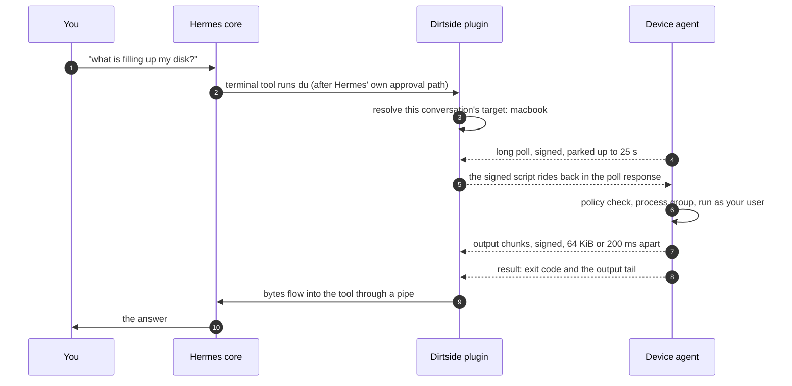

<p align="center">
  <picture>
    <source media="(prefers-color-scheme: dark)" srcset="docs/assets/banner-dark.svg">
    
  </picture>
</p>

<p align="center">
  Hermes Agent keeps thinking on your server.<br>
  The terminal and file tools run on the machine you choose, one choice per conversation.
</p>

<p align="center">
  <a href="https://github.com/the-ai-entrepreneur-ai-hub/hermes-dirtside/actions/workflows/check.yml"></a>
  <a href="https://www.python.org/"></a>
  <a href="https://github.com/NousResearch/hermes-agent"></a>
  
  
  
  <a href="LICENSE"></a>
</p>

<table align="center">
  <tr>
    <td align="center" width="120"><a href="https://www.python.org/"></a><br><sub><b>Python 3.11+</b></sub></td>
    <td align="center" width="120"><a href="https://sqlite.org/wal.html"></a><br><sub><b>SQLite, WAL</b></sub></td>
    <td align="center" width="120"><a href="https://fastapi.tiangolo.com/"></a><br><sub><b>FastAPI routes</b></sub></td>
    <td align="center" width="120"><a href="https://pynacl.readthedocs.io/"></a><br><sub><b>Ed25519, PyNaCl</b></sub></td>
    <td align="center" width="120"><a href="https://www.python-httpx.org/"></a><br><sub><b>httpx long poll</b></sub></td>
  </tr>
  <tr>
    <td align="center" width="120"><a href="https://docs.pytest.org/"></a><br><sub><b>pytest, 314 tests</b></sub></td>
    <td align="center" width="120"><a href="https://docs.astral.sh/ruff/"></a><br><sub><b>Ruff, mccabe 8</b></sub></td>
    <td align="center" width="120"><a href="https://github.com/the-ai-entrepreneur-ai-hub/hermes-dirtside/actions"></a><br><sub><b>CI on two OSes</b></sub></td>
    <td align="center" width="120"><br><sub><b>macOS, launchd</b></sub></td>
    <td align="center" width="120"><br><sub><b>Linux, systemd</b></sub></td>
  </tr>
</table>

<p align="center">
  <a href="#why-dirtside">Why</a> |
  <a href="#sixty-seconds-with-it">Sixty seconds</a> |
  <a href="#quick-start">Quick start</a> |
  <a href="#how-it-works">How it works</a> |
  <a href="#security-model">Security</a> |
  <a href="#numbers">Numbers</a> |
  <a href="#engineering-notes">Engineering</a> |
  <a href="docs/ARCHITECTURE.md">Architecture</a>
</p>

---

## Why Dirtside

Hermes runs on a server so it can answer you from Telegram, Discord, the dashboard or the Desktop app at any hour. That server is not where your code lives. It has no Xcode, no GPU, no photo library, no printer, no half-finished branch in a terminal you forgot to close. When you ask Hermes to build the app or free up disk space, the useful answer is on your laptop.

Dirtside gives each conversation a choice of where the terminal and file tools run: the server, or a machine you paired. The model keeps thinking on the server. The commands land on the device you named. Switch a conversation to `macbook`, keep another one on `gpu-box`, leave your cron jobs on the server.

| Without it | With Dirtside |
|---|---|
| Every command runs on the gateway host. | Each conversation picks a target: `server`, or any paired device. |
| Reaching a machine at home means a VPN, an SSH tunnel or an open port. | The device dials out and long-polls. Nothing listens on it. |
| Trusting the path between the two. | Every message is Ed25519-signed, timestamped and replay-guarded on both ends. |
| A backend swap that changes what the model can do. | No new model tools, no approval bypass. Hermes decides what runs; Dirtside decides where. |

Dirtside is a terminal environment provider, the backend seam Hermes exposes for exactly this. One small package serves both ends: the gateway half registers the provider, the signed routes and the chat commands; the device half is a foreground command that polls your gateway, verifies each script, runs it in a process group under your user and streams signed output back. Nothing is sandboxed. It is your machine.

## Sixty seconds with it

```text
you      /dirtside pair macbook
hermes   Pairing code Q4m9vXr2hZc1Lw8pT6nKb3sYf0GdJ5eUoA7iRqN_tHk expires in 10 minutes. On the device run:
         hermes dirtside pair <gateway-url> --name macbook --code=Q4m9vXr2hZc1Lw8pT6nKb3sYf0GdJ5eUoA7iRqN_tHk

laptop $ hermes dirtside pair https://hermes.example.com --name macbook --code=Q4m9vXr2hZc1Lw8pT6nKb3sYf0GdJ5eUoA7iRqN_tHk
Paired macbook to https://hermes.example.com. Run 'hermes dirtside serve' to connect.
laptop $ hermes dirtside serve

you      /dirtside use macbook
hermes   This conversation now targets macbook (Darwin, online). The change applies to
         this conversation from the next command.

you      what is filling up my disk?
hermes   runs du on macbook through the ordinary terminal tool, reads the output
         back over the relay, and answers from it.
```

The replies above are the exact strings the plugin returns. The last line describes what happens; the model's own words depend on your setup.

## Quick start

### Install on both ends

Install in the Hermes profile that will use it, on the gateway and on each device:

```sh
hermes plugins install https://github.com/the-ai-entrepreneur-ai-hub/hermes-dirtside
hermes plugins enable dirtside
```

On the gateway, select the backend, then restart the gateway and open a new conversation:

```sh
hermes config set terminal.backend dirtside
```

Read the install disclosure before enabling it. The manifest requires Hermes 0.22.7 or newer and Python 3.11 or newer. PyNaCl is the only added dependency. The checks in this README ran against core commit `84a0301415edd6d1385207ec96e4d7f2b6c1fcd9`, not against every supported release.

### Pair in four commands

Chat commands run in an authenticated Hermes conversation on the gateway. Shell commands run on the device.

1. In chat, mint a single-use code:
   ```text
   /dirtside pair macbook
   ```
2. In the device's shell, pair with your gateway URL and the fresh code:
   ```sh
   hermes dirtside pair https://gateway.example --name macbook --code=PASTE_CODE
   ```
3. In that shell, keep the device agent running:
   ```sh
   hermes dirtside serve
   ```
4. In the conversation that should use it:
   ```text
   /dirtside use macbook
   ```

Codes expire after ten minutes. Treat them as secrets; command arguments can land in shell history and process listings. Names are 1 to 32 lowercase letters, digits or hyphens, and `server` is reserved. Any URL that is not loopback must be HTTPS.

### Keep it running

`hermes dirtside serve` stays in the foreground and prints nothing while healthy. `hermes dirtside status` in another shell shows the pairing, the policy and recent activity. For a per-user service:

```sh
hermes dirtside install-service --dry-run   # print the unit, change nothing
hermes dirtside install-service             # write and load it
hermes dirtside install-service --remove    # undo
```

macOS gets a launchd agent, Linux a systemd user unit. Both restart the agent after a crash and leave it stopped after a revoke. Read the unit before installing it; service login and reboot recovery were not exercised in the checks below.

## How it works

<p align="center">
  <picture>
    <source media="(prefers-color-scheme: dark)" srcset="docs/assets/architecture-dark.svg">
    
  </picture>
</p>

One command, start to finish:



The provider hands core a conversation environment that resolves its target at dispatch time, so a `/dirtside use` takes effect on the next command even though core caches environments. The relay holds every live request in memory behind one lock. SQLite keeps pairings, per-conversation choices and a short request log. The device verifies each poll response, checks its policy, starts a process group and streams signed output. No core file is modified.

### What runs where

| Work | Where |
|---|---|
| Terminal commands, shell scripts, file read, write, patch and search | The selected target: the server, or the device. |
| Shell exports and environment snapshots | Kept per target inside the cached conversation environment. |
| Approvals, conversation state, the pairing registry, request metadata | The gateway. |
| Browser and every other non-terminal tool | Their ordinary Hermes backends. Dirtside does not touch them. |
| Device policy, process groups, the device activity log | The device, as the device user. |

Online means contact within 45 seconds. A request on a device that stops reporting is marked lost after 45 seconds plus a 5 second grace period: the tool returns exit 124 with the partial output kept, and says why. Revocation cancels waiting tool calls at once; the device learns of it on its next poll or its next rejected upload. A device that is unreachable may keep running its current command until its own deadline.

## Chat commands

| Command | What it does |
|---|---|
| `/dirtside` | Show this conversation's target and the online devices. |
| `/dirtside devices` | List paired devices with OS and online state. |
| `/dirtside use` | Offer a choice of online devices and `server`. Cancelling changes nothing. |
| `/dirtside use <name>` | Select that device for this conversation, even if it is offline right now. |
| `/dirtside use server` | Pin this conversation to the server, even when the default is a device. |
| `/dirtside pair <name>` | Mint a code and print the exact device-side command. |
| `/dirtside revoke <name>` | Revoke the device and cancel its live requests. |

A change applies from the next command. Work already dispatched keeps its original target. Selecting an offline or revoked device never silently runs that work on the server: the tool fails closed and tells the model why.

Core freezes the system prompt's target facts once per session, so a switch mid-session changes where commands run but not the facts the model was given. Start a new session when that matters.

## Device commands

| Command | What it does |
|---|---|
| `hermes dirtside pair <url> --name <name> --code <code>` | Generate a key pair, register with the gateway, write the device file with mode 0600. |
| `hermes dirtside serve` | Run the device agent in the foreground. |
| `hermes dirtside status` | Show the pairing, the policy and recent local request activity. |
| `hermes dirtside install-service [--dry-run] [--remove]` | Install, print or remove the per-user service. |

## Desktop pane

Install the package on the Desktop machine as well when the gateway is remote. Under Capabilities, Plugins, enable Dirtside (off by default) and open its right-hand pane. If discovery needs a refresh, run "Reload desktop plugins" from the command palette.

The pane lists paired devices with an online dot, OS, home, last seen and a revoke button, shows the focused conversation's target with a picker, and tails the output of recent requests live. A status bar chip shows the current target. Devices and requests poll every two seconds while the pane is visible. The module parses and its SDK calls are tested; the pane was not yet checked inside the running Desktop app.

## Security model

| If this happens | What Dirtside does |
|---|---|
| The laptop lid closes mid-command | Online means contact within 45 s. The request becomes lost after a further 5 s, returns exit 124 with the partial output, and says the device stopped reporting. |
| A poll response is lost on the way to the device | The device's next poll lists the ids it is running. Anything the gateway handed out that never started is queued again, once, and only if it had produced no output. |
| Someone replays a captured message | Every message carries a timestamp and a nonce. Both ends reject timestamps outside 300 s and nonces seen in their 4,096-entry, 300 s cache. |
| A device token leaks | It is useless without the device's private key; pairing pins the public key. `/dirtside revoke` cancels live requests the same second. |
| The model asks for something destructive | The device policy refuses by pattern before anything runs: `sudo`, wiping the root, formatting disks, raw disk writes, shutdown and reboot, stopping its own service, fork bombs, piping a download into a shell. Each command is capped at 900 s, 64 MiB of output and 4 in parallel. Hermes' own approvals stay exactly as they were. |
| The gateway itself is compromised | The deny list is pattern matching, not a sandbox. The device runs what a signed gateway sends, as your user. Treat the gateway host and every pairing code as credentials. |
| The network in between is hostile | The device dials out over HTTPS (plain HTTP only to loopback) and opens no port. Signatures prove who sent what; TLS keeps it private. |

What is kept, and where:

- The gateway stores token hashes, a 120-character preview of each command and its outcome metadata. A 4,096-byte output tail lives in memory only while a request runs.
- The device stores its token, private key and policy in `<hermes home>/dirtside/device.json` with mode 0600, and an activity log of request ids and outcomes, also 0600.
- No telemetry. Dirtside talks to the gateway you paired and to nothing else. Scripts and file contents you ask it to move can still contain secrets, as they would on the server.

The disclosures in `plugin.yaml` say the same in one paragraph: shell execution with the device user's privileges, signed gateway routes, authenticated session controls, outbound polling, pinned keys, device-side deny, timeout, output and parallelism checks, and no filesystem confinement.

## Numbers

Recorded 2026-11-06 at commit `36eda41` on macOS with Python 3.14.6 and core `84a0301`. Both runs are on one machine, so they cover signing, verification, policy, execution and relay delivery, not LAN or internet travel.

### Added cost over core's local backend

| Measurement | Result | Target | Status |
|---|---:|---:|---|
| `pwd`, added latency, p50 | -6.08 ms | <= 15 ms | pass |
| `pwd`, added latency, p95 | 7.79 ms | <= 40 ms | pass |
| 10 MB of output | 12.36 MB/s | >= 8 MB/s | pass |
| `kill()` to tool return | 8.19 ms | <= 50 ms | pass |

Fifty paired samples, nearest-rank percentiles, nothing discarded. The negative median means the two paths differ by less than the run-to-run noise of a shell start, not that the relay is faster than running locally. Throughput verifies all 10,000,000 bytes. Cancellation is measured right after a full chunk; core's own polling can add up to 200 ms to a late cancel of a long call.

### Reliability matrix

| Case | Result | Elapsed |
|---|---|---:|
| Device loses network | pass | 62.50 s |
| Gateway restarts | pass | 8.67 s |
| Device restarts | pass | 4.73 s |
| Concurrent commands | pass | 6.50 s |
| Clock skew | pass | 3.55 s |
| Output flood | pass | 13.52 s |
| Long poll | pass | 28.88 s |
| User interrupt | pass | 4.75 s |

8 of 8, over signed HTTP on loopback with a real gateway app and a real device agent process. Reproduce both:

```sh
export HERMES_SRC=/absolute/path/to/hermes-agent     # a checkout with its venv
"$HERMES_SRC/venv/bin/python" tools/bench.py --loopback
bash scripts/two_machine_matrix.sh --loopback
bash scripts/two_machine_matrix.sh --help            # the two-host form
```

Any missed target exits non-zero. CI prints the benchmark with `--report-only` because shared runners are too noisy to gate on.

## Configuration

Gateway, in the Hermes config:

| Key | Meaning |
|---|---|
| `terminal.backend` | `dirtside` to enable the provider. |
| `plugins.entries.dirtside.settings.default_target` | `server` (default) or a paired device name, used until a conversation chooses. Cron conversations default to the server. |
| `terminal.cwd` | Leave unset. Core expands a configured `~` on the gateway, and Dirtside does not translate that path. |

Device, in `<hermes home>/dirtside/device.json` (written by `pair`, mode 0600): the gateway URL, the device identity, its token and signing key, the gateway's public key, and the policy block with `deny_patterns`, `max_timeout_s`, `max_output_bytes` and `max_parallel`. Edit the policy for your machine, then restart `serve`.

## Project layout

```text
dirtside/                 one package, both halves
  __init__.py             register(ctx): provider, auth, routes, CLI, /dirtside, prompt section
  model.py                frozen dataclasses and the constants (45 s online, 25 s poll, 64 KiB chunks)
  protocol.py             canonical JSON, Ed25519 sign and verify, replay guard, one parser per message
  registry.py             SQLite: devices, per-conversation targets, request log
  relay.py                live requests behind one lock: queue, chunks, cancel, lost detection
  environment.py          core's BaseEnvironment with a pipe as the process handle
  provider.py             the conversation environment and target resolution
  auth.py                 the dashboard auth provider for the four device routes
  commands.py             /dirtside
  prompt.py               the target facts for the system prompt
  cli.py                  hermes dirtside pair, serve, status, install-service
  agent/                  the device half: config, poll loop, executor, policy, activity log
dashboard/plugin_api.py   the routes, mounted under /api/plugins/dirtside/
desktop/plugin.js         the Desktop pane and status chip, plain ESM, no build step
tools/                    benchmark, fake device, size budgets, matrix runner
scripts/                  two_machine_matrix.sh
tests/                    314 tests: units, the conformance battery, real-core and network runs
docs/ARCHITECTURE.md      the design, with the reasons and the alternatives that lost
openspec/                 the change records each build step was made from
```

## Engineering notes

- Every module has a line budget that `tools/check_sizes.py` enforces (the relay gets 204 lines, the protocol 147) and no function may exceed a cyclomatic complexity of 8. The whole plugin is 1,872 lines of source and 4,103 lines of tests.
- The conformance battery runs the same commands through core's local backend and through Dirtside and compares exit codes, output, truncation and timeout rendering. If core would show you a message, Dirtside shows the same one.
- The integration tests use the real core: the plugin is loaded by Hermes' own loader, driven through its own terminal and file tools, and mounted by its own dashboard with the auth gate on. Two defects that only the real core could reveal were found this way and fixed.
- The gateway owns every timeout. The device deadline is one second longer and only matters when the gateway is gone, so what you see never depends on which side of the network fired first.
- CI runs the full suite on Ubuntu and macOS against the pinned core commit on every push.
- The build went in six steps, each from a written change record in `openspec/` with a proposal, a design and tasks, and each closed by a review in a fresh context. The last review found eleven defects; every one was fixed with a test that failed first.

## Status

Verified: everything in this README on one machine over loopback, the suite on both CI runners, and the catalog validator's checks on a clean clone. Not yet verified: two physical hosts over the internet, the pane inside the running Desktop app, and service behaviour across login and reboot. The two-host matrix is one command away; the script has a remote mode.

## License

MIT. See [LICENSE](LICENSE).

<p align="center">
  <sub>Built by George Kioko for the Hermes Agent plugin hackathon, November 2026.</sub>
</p>
