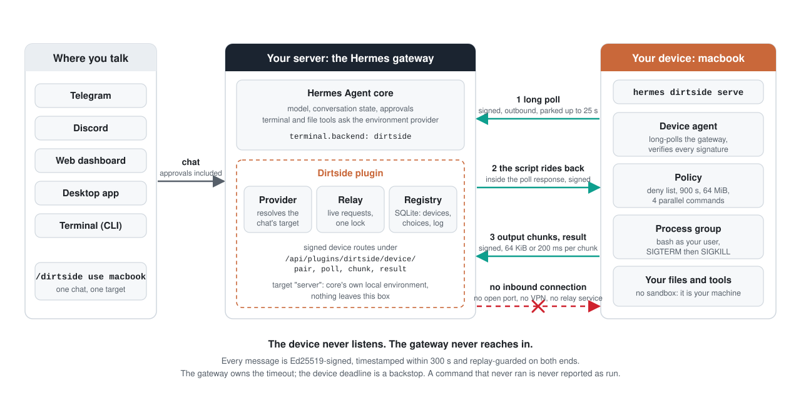
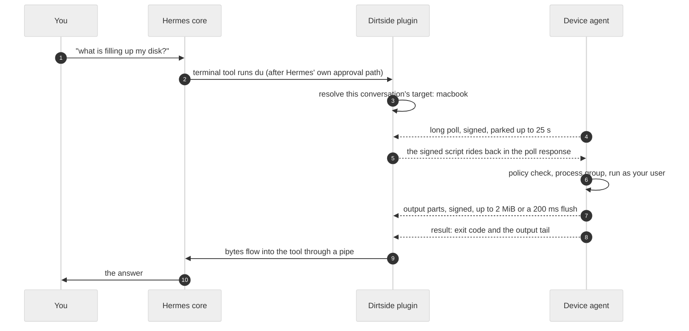

<p align="center">
  <picture>
    <source media="(prefers-color-scheme: dark)" srcset="docs/assets/banner-dark.svg">
    
  </picture>
</p>

<p align="center">
  Hermes Agent keeps thinking on your server. The terminal commands run on the machine you choose, one choice per conversation.
</p>

<p align="center">
  <a href="https://github.com/the-ai-entrepreneur-ai-hub/hermes-dirtside/actions/workflows/check.yml"></a>
  <a href="https://www.python.org/"></a>
  <a href="https://github.com/NousResearch/hermes-agent"></a>
  
  
  <a href="LICENSE"></a>
</p>

<p align="center">
  <a href="https://www.python.org/"></a>
  <a href="https://sqlite.org/wal.html"></a>
  <a href="https://fastapi.tiangolo.com/"></a>
  <a href="https://docs.pytest.org/"></a>
  <a href="https://docs.astral.sh/ruff/"></a>
  <a href="https://github.com/the-ai-entrepreneur-ai-hub/hermes-dirtside/actions"></a>
  
  
  <a href="https://pynacl.readthedocs.io/"></a>
  <a href="https://www.python-httpx.org/"></a><br>
  <sub>Python 3.11+, SQLite in WAL mode, FastAPI routes, Ed25519 through PyNaCl, httpx long polling, pytest, Ruff, GitHub Actions, launchd, systemd</sub>
</p>

<p align="center">
  <a href="#why-dirtside">Why</a> |
  <a href="#sixty-seconds-with-it">Sixty seconds</a> |
  <a href="#quick-start">Quick start</a> |
  <a href="#how-it-works">How it works</a> |
  <a href="#security-model">Security</a> |
  <a href="#numbers">Numbers</a> |
  <a href="#engineering-notes">Engineering</a> |
  <a href="docs/ARCHITECTURE.md">Architecture</a>
</p>

---

## Why Dirtside

Hermes runs on a server so it can answer you from Telegram, Discord, the dashboard or the Desktop app at any hour. That server is not where your code lives. It has no Xcode, no GPU, no photo library, no printer, no half-finished branch in a terminal you forgot to close. When you ask Hermes to build the app or free up disk space, the useful answer is on your laptop.

Dirtside gives each conversation a choice of where terminal commands run: the server, or a machine you paired. The model keeps thinking on the server. The commands land on the device you named. Switch a conversation to `macbook`, keep another one on `gpu-box`, leave your cron jobs on the server.

File-tool limit: core resolves file paths on the gateway; use the terminal for edits on a device.

| Without it | With Dirtside |
|---|---|
| Every command runs on the gateway host. | Each conversation picks a target: `server`, or any paired device. |
| Reaching a machine at home means a VPN, an SSH tunnel or an open port. | The device dials out and long-polls. Nothing listens on it. |
| Trusting the path between the two. | Every message is Ed25519-signed, timestamped and replay-guarded on both ends. |
| A backend swap that changes what the model can do. | No new model tools, no approval bypass. Hermes decides what runs; Dirtside decides where. |

Dirtside is a terminal environment provider, the backend seam Hermes exposes for exactly this. One small package serves both ends: the gateway half registers the provider, the signed routes and the chat commands; the device half is a foreground command that polls your gateway, verifies each script, runs it in a process group under your user and streams signed output back. Nothing is sandboxed. It is your machine.

## Sixty seconds with it

```text
you      /dirtside pair macbook
hermes   Pairing code Q4m9vXr2hZc1Lw8pT6nKb3sYf0GdJ5eUoA7iRqN_tHk
         expires in 10 minutes. On the device run:
         hermes dirtside pair <gateway-url> --name macbook \
           --code=Q4m9vXr2hZc1Lw8pT6nKb3sYf0GdJ5eUoA7iRqN_tHk

laptop $ hermes dirtside pair https://hermes.example.com --name macbook \
           --code=Q4m9vXr2hZc1Lw8pT6nKb3sYf0GdJ5eUoA7iRqN_tHk
Paired macbook to https://hermes.example.com. Run 'hermes dirtside serve' to connect.
laptop $ hermes dirtside serve
Dirtside env_passthrough: none

you      /dirtside use macbook
hermes   This conversation now targets macbook (Darwin, online). The change
         applies to this conversation from the next command.

you      what is filling up my disk?
hermes   runs du on macbook through the ordinary terminal tool, reads the
         output back over the relay, and answers from it.
```

The replies are the plugin's own words, wrapped to fit here. The last line describes what happens; the model's phrasing depends on your setup.

## Quick start

### Install on both ends

Install in the Hermes profile that will use it, on the gateway and on each device:

```sh
hermes plugins install https://github.com/the-ai-entrepreneur-ai-hub/hermes-dirtside
hermes plugins enable dirtside
```

On the gateway, select the backend, then restart the gateway and open a new conversation:

```sh
hermes config set terminal.backend dirtside
```

Read the install disclosure before enabling it. The manifest requires Hermes 0.22.7 or newer and Python 3.11 or newer. PyNaCl is the only added dependency. The catalog-review checks use core commits `84a0301415edd6d1385207ec96e4d7f2b6c1fcd9` and `8d7061f`, not every supported release; the dated numbers below describe their stated earlier run.

After a plugin update, restart even a CLI auto-started gateway (`gateway run --quiet --idle-exit`); it keeps its previously loaded plugin code until it exits.

### Pair in four commands

Chat commands run in an authenticated Hermes conversation on the gateway. Shell commands run on the device.

1. In chat, mint a single-use code:
   ```text
   /dirtside pair macbook
   ```
2. In the device's shell, pair with your gateway URL and the fresh code:
   ```sh
   hermes dirtside pair https://gateway.example --name macbook --code=PASTE_CODE
   ```
3. In that shell, keep the device agent running:
   ```sh
   hermes dirtside serve
   ```
4. In the conversation that should use it:
   ```text
   /dirtside use macbook
   ```

Codes expire after ten minutes. Treat them as secrets; command arguments can land in shell history and process listings. Names are 1 to 32 lowercase letters, digits or hyphens, and `server` is reserved. Any URL that is not loopback must be HTTPS.

A gateway reached through a tunnel or reverse proxy needs its public URL configured: run `hermes config set dashboard.public_url https://<public hostname>` on the gateway and restart it. Otherwise core refuses pairing with "Invalid Host header. Dashboard requests must use the bound hostname or the configured public hostname."

### Keep it running

`hermes dirtside serve` stays in the foreground, prints the allowed passthrough names once at startup, then stays quiet while healthy. `hermes dirtside status` in another shell shows the pairing, the policy and recent activity. For a per-user service:

```sh
hermes dirtside install-service --dry-run   # print the unit, change nothing
hermes dirtside install-service             # write and load it
hermes dirtside install-service --remove    # undo
```

macOS gets a launchd agent, Linux a systemd user unit. Both restart the agent after a crash. Only an explicit `401 {"detail":"device revoked"}` stops `serve` successfully; generic core authentication failures and unknown credentials retry with backoff. Released cores can reject revoked tokens before that signal reaches the plugin, so stop or re-pair that agent yourself. Read the unit before installing it; service login and reboot recovery were not exercised in the checks below.

## How it works

<p align="center">
  <picture>
    <source media="(prefers-color-scheme: dark)" srcset="docs/assets/architecture-dark.svg">
    
  </picture>
</p>

One command, start to finish:



The provider hands core a conversation environment that resolves its target at dispatch time, so a `/dirtside use` takes effect on the next command even though core caches environments. The relay holds every live request in memory behind one lock. SQLite keeps pairings, per-conversation choices and a short request log. The device verifies each poll response, checks its policy, starts a process group and streams signed output. No core file is modified.

Any number of gateway or dashboard processes may mount the routes, but only the process receiving verified device traffic owns the relay; every other process, including the unmanaged gateway that `hermes chat` may auto-start, reaches that owner over authenticated loopback HTTP. The local secret stays on the machine; workers do not start another relay service.

### What runs where

| Work | Where |
|---|---|
| Terminal commands and shell scripts | The selected target: the server, or the device. |
| File read, write, patch and search | The selected backend, with the gateway-side path-resolution limit above. |
| Shell exports and environment snapshots | Kept per target inside the cached conversation environment. |
| Approvals, conversation state, the pairing registry, request metadata | The gateway. |
| Browser and every other non-terminal tool | Their ordinary Hermes backends. Dirtside does not touch them. |
| Device policy, process groups, the device activity log | The device, as the device user. |

Online means contact within 45 seconds. A request on a device that stops reporting is marked lost after 45 seconds plus a 5 second grace period: the tool returns exit 255 with the partial output kept, and says why. Revocation cancels waiting tool calls at once. An explicit revoked signal stops device work; generic authentication rejection only retries, so stop the agent yourself if that signal cannot reach it. After a gateway restart, the next successful poll also stops orphaned work. An unreachable or generically rejected device may keep running its current command until its own deadline.

## Chat commands

| Command | What it does |
|---|---|
| `/dirtside` | Show this conversation's target, visible online devices and your Sender identity. |
| `/dirtside devices` | List only devices you may use, with OS and online state. |
| `/dirtside use` | Offer visible online devices and `server`. Cancelling changes nothing. |
| `/dirtside use <name>` | Select that device for this conversation, even if it is offline right now. |
| `/dirtside use server` | Pin this conversation to the server, even when the default is a device. |
| `/dirtside pair <name>` | Mint a code owned by you, if allowed, and print the device-side command. |
| `/dirtside revoke <name>` | Revoke a device you may manage and cancel its live requests. |

A device belongs to the sender who minted its pairing code. Identity is the exact `platform:user_id` from trusted session context; status prints it as `Sender` so the gateway owner can copy it into `plugins.entries.dirtside.settings.owners`. The device owner, `local`, and identities in that list can use and manage the device. Other senders cannot list its facts or take its active or pending name. `use` and `revoke` refusals look like a missing name. Pairing reveals whether a name is available: a foreign occupied name refuses while a free name yields a code.

With `owners` empty (the default), any admitted sender with a known identity may pair a new name and owns it. With a nonempty list, only `local` and listed owners may pair new names. The list accepts at most 64 unique identities. Reload the plugin or restart the gateway after changing it; a worker-only change cannot widen the serving owner's permissions.

This includes an unused configured default name; the name alone grants no trust. Re-pairing reuses an id only for the same owner. A different owner gets a new id, immediately cancels the previous device's live gateway requests, and leaves old conversation selections revoked instead of redirecting them. A privileged sender explicitly selecting an unprivileged owner's device sees that owner in the confirmation.

Core's canonical platform `local` is the host only with trusted CLI, TUI, Desktop or ACP policy provenance and an empty user or exactly the current process's `uid:<n>`. A policy-free surface `local`, as used by native slash commands, additionally requires core's actual non-relay command source; a relay payload's `local` label or matching chat/session ids grant no host authority. Other uid or arbitrary raw subjects are not the host. Core maps all dashboard and Webapp sign-ins, including forwarded logins, to the gateway host owner, so they act as `local` on POSIX gateways. Windows gateways' `sid:` subjects are not recognized as the host yet. Legacy empty-user host provenance and cron stay unchanged, and old pairings migrate to `local`. Messaging users named `local` or the host uid do not gain host authority. Missing identity fails closed. The prepared cores' direct ACP adapter omits the required public provenance: canonical ACP context is supported, but ambiguous direct-ACP device access remains denied until core binds it.

Every terminal and file call checks the current turn's sender, including cached group conversations and the local worker hop. Another participant cannot inherit the sender's selected device.

Each device keeps its own working directory and exports within the conversation.

A change applies from the next command. Work already dispatched keeps its original target. An explicitly selected device that is offline, revoked or not yours fails closed, never on the server. An implicit device default must be yours or owned by `local` or a listed owner, and you must still be authorized to use it. Otherwise it resolves to server, even for a privileged sender; select an unprivileged owner's device explicitly. A missing or revoked configured default still fails closed. Cron still defaults to the server.

The configured default is captured at a conversation's first target resolution, including its first prompt render. Reloaded defaults apply to new conversations; existing ones retain their captured name through idle cleanup and disable/re-enable. Explicit choices still change the next command; clearing one restores that conversation's captured default. Pre-upgrade conversations capture it on their first resolution under this version, since already frozen prompt bytes cannot be reconstructed.

Core freezes the system prompt's target facts once per session, so a switch mid-session changes where commands run but not the facts the model was given. Start a new session when that matters.

This is not per-sender prompt privacy in a shared conversation. Other participants can receive the first render's device name, OS, home and online state in the model context, even when their own device calls are denied. Those facts can also be stale. Use separate conversations for private device facts; per-turn execution authorization does not erase a frozen prompt.

## Device commands

| Command | What it does |
|---|---|
| `hermes dirtside pair <url> --name <name> --code=<code>` | Generate a key pair, register with the gateway, write the device file with mode 0600. |
| `hermes dirtside serve` | Run the device agent in the foreground. |
| `hermes dirtside status` | Show the pairing, the policy and recent local request activity. |
| `hermes dirtside policy` | Show passthrough names, never values. |
| `hermes dirtside policy --env-passthrough NAME ...` | Replace the allowed names on this paired device. |
| `hermes dirtside policy --clear-env-passthrough` | Clear the allowed names on this paired device. |
| `hermes dirtside install-service [--dry-run] [--remove]` | Install, print or remove the per-user service. |

Model commands inherit only set `PATH`, `HOME`, `USER`, `LANG`, `LC_*`, `TERM` and `TMPDIR`, plus names in the device policy's `env_passthrough`. The agent keeps its own environment; the gateway cannot add names over the wire. Shell startup files can still set variables, and commands can still read the device user's files.

Re-pairing preserves a safely readable, valid device file's `env_passthrough` names, never their values. If the old file is unreadable, unsafe or invalid, pairing prints a short note and resets those names to none. Other policy fields reset to the defaults, as before; review them and restart `serve` after re-pairing.

On the paired device, allow only what your work needs:

```sh
hermes dirtside policy
hermes dirtside policy --env-passthrough SSH_AUTH_SOCK WSL_INTEROP DISPLAY
hermes dirtside policy --clear-env-passthrough
```

`SSH_AUTH_SOCK` enables an existing SSH agent, and `DISPLAY` lets programs reach an existing graphical display. Names must match `[A-Za-z_][A-Za-z0-9_]{0,127}`, with at most 64 and no duplicates; declared but unset names stay absent. Changes take effect at the next `serve` start, whose disclosure also prints names only.

On WSL2, a Windows `.exe` needs WSL interop enabled, its binfmt handler and a usable executable path, for example `/mnt/c/Windows/System32/cmd.exe`. `WSL_INTEROP` selects a live interop-server socket. If it is unset, `/init` also searches the process and its parent chain for `/run/WSL/<pid>_interop`, so the variable is not universally required. Pass through the existing value when that fallback cannot find a live server. Setting it cannot enable disabled interop or revive a dead socket. See the [WSL interop contract](https://wsl.dev/technical-documentation/interop/).

## Desktop pane

Install the package on the Desktop machine as well when the gateway is remote. Under Capabilities, Plugins, enable Dirtside (off by default) and open its right-hand pane. If discovery needs a refresh, run "Reload desktop plugins" from the command palette.

The pane lists paired devices with an online dot, OS, home, last seen and a revoke button, shows the focused conversation's target with a picker, and tails the output of recent requests live. A status bar chip shows the current target. Devices and requests poll every two seconds while the pane is visible. The module parses and its SDK calls are tested; the pane was not yet checked inside the running Desktop app.

## Security model

| If this happens | What Dirtside does |
|---|---|
| The laptop lid closes mid-command | Online means contact within 45 s. The request becomes lost after a further 5 s, returns exit 255 with the partial output, and says the device stopped reporting. |
| A poll response is lost on the way to the device | The device's next poll lists the ids it is running. Anything the gateway handed out that never started is queued again, once, and only if it had produced no output. |
| Someone replays a captured message | Every message carries a timestamp and a nonce. Both ends reject timestamps outside 300 s and nonces seen in their 4,096-entry, 300 s cache. |
| A device token leaks | It is useless without the device's private key; pairing pins the public key. `/dirtside revoke` cancels live gateway requests immediately. If core returns only generic authentication errors, stop the agent yourself to terminate its remaining local work. |
| A model command inherits device-agent credentials | Children get the minimal environment plus device-owned `env_passthrough`, not the agent's provider keys by default; this is not filesystem isolation, and explicit passthrough can expose secrets. |
| Another admitted sender shares the conversation | Discovery and management are owner-filtered, and terminal/file dispatch checks each sender again; a cached target does not grant access. The trusted gateway host and configured owners retain authority. |
| A participant can run arbitrary commands on the server target | Server-target execution is gateway-user execution, not device-owner isolation. It can read `local.secret` and call the local API as `local`, including another owner's devices. Restrict gateway execution through core's approvals and allowlists; Dirtside cannot isolate senders sharing that OS account. |
| The model asks for something destructive | The device policy refuses by pattern before anything runs: `sudo`, wiping the root, formatting disks, raw disk writes, shutdown and reboot, stopping its own service, fork bombs, piping a download into a shell. Default caps are 900 s, 64 MiB of output and 4 commands in parallel. Hermes' own approvals stay exactly as they were. |
| The gateway itself is compromised | The deny list is pattern matching, not a sandbox. The device runs what a signed gateway sends, as your user. Treat the gateway host and every pairing code as credentials. |
| The network in between is hostile | The device dials out over HTTPS (plain HTTP only to loopback) and opens no port. Signatures prove who sent what; TLS keeps it private. |

What is kept, and where:

- The gateway stores token hashes, a 120-character preview of each command and its outcome metadata. A 4,096-byte output tail lives in memory only while a request runs.
- The device stores its token, private key and policy in `<hermes home>/dirtside/device.json` with mode 0600, and an activity log of request ids and outcomes, also 0600.
- No telemetry. Dirtside talks to the gateway you paired and to nothing else. Scripts and file contents you ask it to move can still contain secrets, as they would on the server.

The disclosures in `plugin.yaml` say the same in one paragraph: shell execution with the device user's privileges, signed gateway routes, authenticated session controls, outbound polling, pinned keys, device-side deny, timeout, output and parallelism checks, and no filesystem confinement.

## Numbers

Recorded 2026-11-06 at commit `fbb2f5f` on macOS with Python 3.14.6 and core `84a0301`. Both modes run on one machine, so these measurements cover signing, verification, policy, execution and relay delivery, not LAN or internet travel. The [catalog PR](https://github.com/NousResearch/hermes-agent/pull/149883) records the published pin.

### Added cost over core's local backend

| Measurement | Result | Target | Status |
|---|---:|---:|---|
| `pwd`, added latency, p50 | 5.97 ms | <= 15 ms | pass |
| `pwd`, added latency, p95 | 8.89 ms | <= 40 ms | pass |
| 10 MB of output | 16.01 MB/s | >= 8 MB/s | pass |
| `kill()` to tool return | 5.34 ms | <= 50 ms | pass |
| `pwd`, added latency, p50, client mode | 29.55 ms | report only | measured |
| `pwd`, added latency, p95, client mode | 33.12 ms | report only | measured |

Fifty paired samples, nearest-rank percentiles, nothing discarded. Throughput verifies all 10,000,000 bytes. Cancellation is measured at the RUNNING claim, without waiting for output; core's own polling can add up to 200 ms to a late cancel of a long call.

Client mode runs the tool outside the device-polled owner process and reaches its relay over authenticated loopback HTTP. These rows come from the same run and do not gate the benchmark.

### Reliability matrix

| Case | Result | Elapsed |
|---|---|---:|
| Device loses network | pass | 61.93 s |
| Gateway restarts | pass | 11.85 s |
| Device restarts | pass | 4.91 s |
| Concurrent commands | pass | 6.68 s |
| Clock skew | pass | 3.94 s |
| Output flood | pass | 12.60 s |
| Long poll | pass | 29.06 s |
| User interrupt | pass | 5.03 s |

8 of 8, over signed HTTP on loopback with a real gateway app and a real device agent process.

### Two machines over the internet

On 2026-11-06 the eight rows ran across two physical machines over the public internet at commit `fbb2f5f` on both ends: the gateway on a Mac behind an HTTPS tunnel, the device on another machine's WSL2 Arch Linux in another city. 8 of 8. The table reports the run's row times and its link probe.

| Case | Result | Elapsed | Measured rate |
|---|---|---:|---|
| Device loses network | pass | 82.30 s | not measured |
| Gateway restarts | pass | 32.63 s | not measured |
| Device restarts | pass | 24.81 s | not measured |
| Concurrent commands | pass | 21.51 s | not measured |
| Clock skew | pass | 17.72 s | not measured |
| Output flood | pass | 471.50 s | 0.236 MB/s (probe) |
| Long poll | pass | 56.59 s | not measured |
| User interrupt | pass | 19.91 s | not measured |

The signed-part link probe measured 0.236 MB/s and a 0.425 s round trip through the actual tunnel path, which gave the flood command a 593 s budget; the row took 471.50 s. The table's rate is the probe rate, not flood payload throughput. An earlier 64 KiB-part run passed 7 of 8; its flood row ended after 105.73 s with the rig's wait timeout, not a recorded core timeout at 120 s. The device now sends 2 MiB parts and the rig sizes the budget from a measured probe.

The rig now waits for the command timeout plus 15 s. The device coalesces pending output into signed parts up to 2 MiB and starts sending small output within 200 ms when no earlier upload is in flight. One upload stays in flight, in sequence. Continuously available 64 MiB output fits in 32 full parts; at an assumed 0.7 s round trip that is 22.4 s in round trips alone, not a measured internet completion time. Remote runs derive the flood budget from their signed-path link probe rather than an assumed access-link speed.

Reproduce the loopback runs:

```sh
export HERMES_SRC=/absolute/path/to/hermes-agent     # a checkout with its venv
"$HERMES_SRC/venv/bin/python" tests/bench.py --loopback
bash scripts/two_machine_matrix.sh --loopback
bash scripts/two_machine_matrix.sh --help            # the two-host form
```

Any missed target exits non-zero. CI prints the benchmark with `--report-only` because shared runners are too noisy to gate on.

## Configuration

Gateway, in the Hermes config:

| Key | Meaning |
|---|---|
| `terminal.backend` | `dirtside` to enable the provider. |
| `plugins.entries.dirtside.settings.default_target` | `server` (default) or a paired device name, captured at each conversation's first target resolution until it explicitly chooses. Changed settings apply to new conversations. Blank or null values mean server. Cron conversations default to the server. |
| `plugins.entries.dirtside.settings.owners` | List of trusted `platform:user_id` identities with authority over every device; default `[]`, at most 64 unique entries. Copy the exact Sender string from status. |
| `terminal.cwd` | Leave unset. Core expands a configured `~` on the gateway, and Dirtside does not translate that path. |

Device, in `<hermes home>/dirtside/device.json` (written by `pair`, mode 0600): the gateway URL, the device identity, its token and signing key, the gateway's public key, and the policy block with `deny_patterns`, `max_timeout_s`, `max_output_bytes`, `max_parallel` and `env_passthrough`. Old four-key policy files still load with an empty passthrough list; saving adds it. Edit the policy for your machine or use the names-only `policy` command, then restart `serve`.

## Project layout

```text
dirtside/                 one package, both halves
  __init__.py             register(ctx): provider, auth, routes, CLI, commands
  model.py                frozen dataclasses and the protocol constants
  protocol.py             canonical JSON, Ed25519 sign and verify, replay guard
  registry.py             SQLite: devices, per-conversation targets, request log
  relay.py                live requests behind one lock: queue, chunks, cancel
  environment.py          core's BaseEnvironment with a pipe as the handle
  provider.py             the conversation environment and target resolution
  backend.py              public workdir middleware and lazy core-local handoff
  access.py               current sender identity and device owner authority
  auth.py                 auth provider and nine scoped token-route paths
  commands.py             /dirtside
  prompt.py               the target facts for the system prompt
  cli.py                  hermes dirtside pair, serve, status, policy, install-service
  agent/                  the device half: config, loop, executor, policy, log
dashboard/plugin_api.py   the routes, under /api/plugins/dirtside/
desktop/plugin.js         Desktop pane and status chip, plain ESM, no build
tools/                    fake device, owned rig, size budgets, matrix runner
scripts/                  two_machine_matrix.sh
tests/                    927 tests: units, conformance, real core, network; benchmark helpers
docs/ARCHITECTURE.md      the design, its reasons, the alternatives that lost
openspec/                 the change record behind each build step
```

## Engineering notes

- Every module has a line budget that `tools/check_sizes.py` enforces (the relay gets 239 lines, the protocol 147) and no function may exceed a cyclomatic complexity of 8. The hard file cap is 400 lines.
- The conformance battery runs the same commands through core's local backend and through Dirtside and compares exit codes, output, truncation and timeout rendering. If core would show you a message, Dirtside shows the same one.
- The integration tests use the real core: the plugin is loaded by Hermes' own loader, driven through its own terminal and file tools, and mounted by its own dashboard with the auth gate on. Two defects that only the real core could reveal were found this way and fixed.
- Core owns requested timeout rendering. The device backstop is the requested timeout plus one second, capped by device policy; a stricter device policy can stop work sooner. Timeout, refusal, cancellation and loss keep distinct exit codes.
- CI runs the full suite on Ubuntu and macOS against the pinned core commit on every push.
- The build is tracked in `openspec/` with proposals, designs and tasks. Review findings and regression logs live in the private development notes.
- Ordinary rediscovery preserves explicitly compatible live runtimes and in-flight work. Local execution and stream attachment retry only the exact temporary disabled-route 401 for up to three seconds, retaining the request id; other failures are not replayed. After disable/re-enable, cached environments reach the current owner through loopback instead of abandoned queues; an owner not yet ready fails closed. Do not expect in-flight work to survive a full disable/re-enable. Restart after code updates to replace already-mounted method bodies.

## Status

The suite collects 927 tests. Catalog-review checks use core `84a0301` and `8d7061f` on macOS; CI runs Ubuntu and macOS against the pinned core. Native authenticated CLI slash dispatch and one-shot turns, plus TUI slash/turn RPCs, run the device demo with temporary homes and a loopback model on both prepared cores. This is not a check of the owner's live install or rendered TUI. The dated measurements above and the live checks below describe the earlier published tree, not new internet or Desktop checks on this worktree.

Three private uses remain transitional: the lazy `token_auth.register_token_route` fallback keeps released cores working until provider-bound, scoped route registration exists; lazy `LocalEnvironment` preserves core's local behavior and credential stripping until a public backend handoff exists; `EnvironmentConnectionError` preserves core's fail-closed rendering and needs documenting in the provider contract. The catalog validator still reports exactly those three sites; this is not a claim of catalog approval.

Inside a real Hermes install (v0.23.0), from the CLI and from gateway sessions with two paired devices and one of them reached through a public tunnel: choosing a device for terminal commands, shell state across turns, switching devices mid-conversation after a `cd` (each device keeps its own working directory), a 1 MB output, a timeout, the deny list, core's dangerous-command block, fail-closed with the device agent stopped or the device revoked, re-pairing, a revoke during a live command, and a gateway restart during a live command, including a silent one that the device stopped at its next poll. In the owner's switch check, the Mac's `Dirtside Demo` folder was restored after the WSL2 Linux device ran `cd ~/work/api && make test` successfully. The owner's 2026-11-09 Mac-gateway/WSL2-device check found an absolute read working but a write resolving its parent on the Mac; that supplied observation is the file-tool limit above, not a new reproduction here. Across two physical machines over the internet, 8 of 8 with the probe reported above. Not yet verified: the pane inside the running Desktop app, and service behaviour across login and reboot.

## License

MIT. See [LICENSE](LICENSE).

<p align="center">
  <sub>Built by George Kioko for the Hermes Agent plugin hackathon, November 2026.</sub>
</p>
